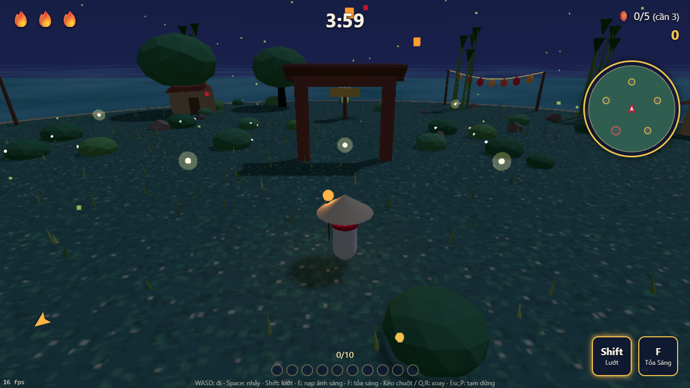
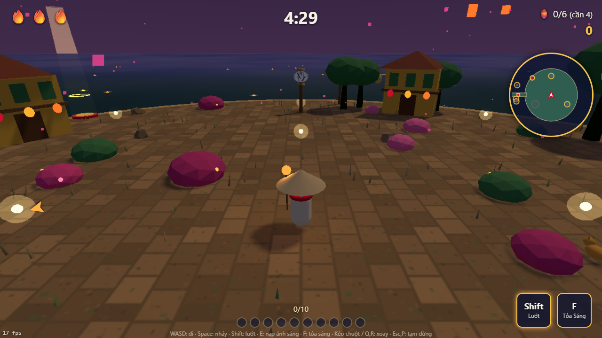
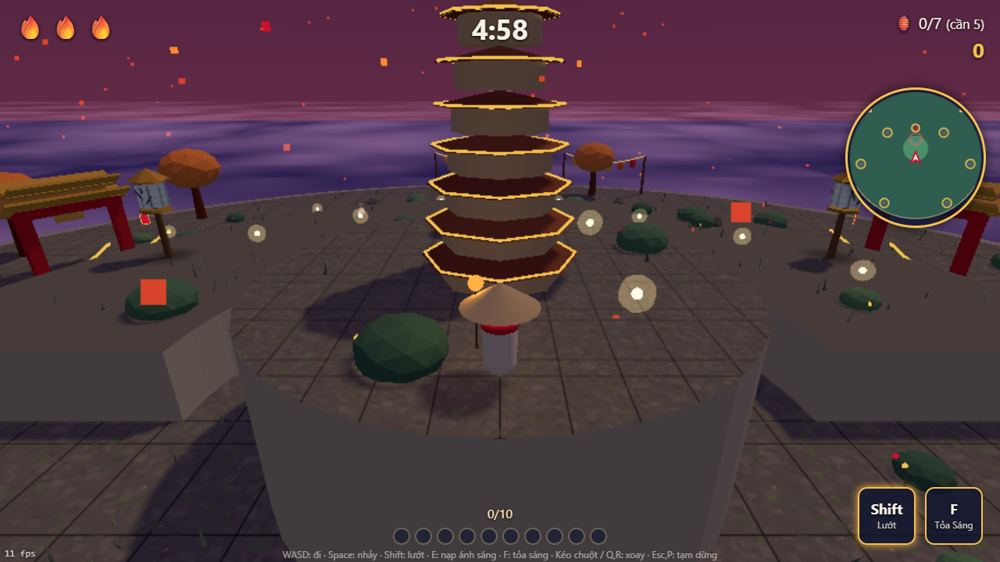

# Đảo Đèn Lồng — v1.0.0

> **Video demo (4 phút 5 giây):** [docs/demo/demo.mp4](docs/demo/demo.mp4) · cũng đính kèm ở [Release v1.0.0](https://github.com/flying-bug/K5-L3A-DAY12-DoDuyBo-2A202603591-AI-SDLC-Dao-Den-Long/releases/tag/v1.0.0). Gồm: màn hình chính, chơi 3 Đêm, bản điện thoại, rồi output thật của `npm test`, headless, benchmark, soak, git và harness. Phần chơi do script (bot) điều khiển để quay tự động, có ghi trên màn hình.
>
> **Chơi online (GitHub Pages):** https://flying-bug.github.io/K5-L3A-DAY12-DoDuyBo-2A202603591-AI-SDLC-Dao-Den-Long/ — vào thẳng Đêm 2: [`?night=2`](https://flying-bug.github.io/K5-L3A-DAY12-DoDuyBo-2A202603591-AI-SDLC-Dao-Den-Long/?night=2). Bản online lưu bảng xếp hạng trong trình duyệt; bản chạy bằng `npm start` lưu trên đĩa.

Game 3D góc nhìn thứ ba. Mây, cô bé giữ đèn đội nón lá, gom đom đóm để thắp và **giữ sáng các Đèn Lồng Lớn tới bình minh** qua ba Đêm mang bối cảnh Việt Nam: **Làng quê Bắc Bộ**, **Phố cổ Hội An** và **Cố đô Huế**. Bóng Mực hút dầu những ngọn đèn yếu, Gió Lạc cướp đom đóm. Toàn bộ luật nằm trong một lõi JavaScript tất định (`src/sim.js`, 60 tick/giây) dùng chung cho bản 3D (three.js), chế độ headless, benchmark và soak test.

| Làng quê Bắc Bộ | Phố cổ Hội An | Cố đô Huế |
|---|---|---|
|  |  |  |

## Yêu cầu hệ thống

- **Node.js ≥ 18** (đã thử với Node 24), macOS / Linux / Windows.
- Trình duyệt hỗ trợ WebGL2 (Chrome, Edge, Firefox, Safari mới). Benchmark cần **Chrome, Edge hoặc Chromium** (tự tìm, hoặc `--browser <đường dẫn>` / biến `CHROME`).
- GPU tích hợp là đủ: trên Intel UHD Graphics benchmark đạt ~105 FPS.

## Cài đặt và chạy (3 lệnh)

```bash
git clone <repo> && cd K5-L3A-DAY12-DoDuyBo-2A202603591-AI-SDLC-Dao-Den-Long
npm install        # build_cmd: chỉ cài three.js
npm start          # run_cmd: mở http://localhost:8080
```

Không muốn cài gì ngoài Node: tải `dao-den-long-v1.0.0.tar.gz` ở Release, giải nén, chạy `node scripts/serve.js` (three.js đã kèm sẵn). Có `Dockerfile`: `docker build -t dao-den-long . && docker run -p 8080:8080 dao-den-long`.

## Điều khiển (đổi được trong Cài đặt → Phím điều khiển)

| Mặc định | Hành động |
|---|---|
| W A S D | Di chuyển theo hướng camera |
| Space | Nhảy |
| Shift trái | Lướt (14 m/s, 0.2 s, hồi 1.5 s) |
| E | Thắp đèn / thắp lại / châm dầu (trong 2 m) |
| F | Tỏa Sáng: choáng và đẩy lùi Bóng Mực (tốn 3 đom đóm) |
| Kéo chuột, Q / R | Xoay camera |
| Esc | Tạm dừng (Tiếp tục / Chơi lại Đêm / Hướng dẫn / Cài đặt / Về menu) |

**Điện thoại / máy tính bảng** (tự nhận khi màn hình cảm ứng): joystick bên trái để đi, vuốt màn hình để xoay camera, nút **Nhảy / Lướt / Thắp / Tỏa sáng** bên phải (có hiện hồi chiêu), nút **II** để tạm dừng. Nên xoay ngang. Thử trên giả lập điện thoại của Chrome (844×390, cảm ứng): đi, nhảy, xoay camera, tạm dừng đều chạy ([ảnh](docs/proof/phase-4/ui-mobile-play.png)); **chưa thử trên điện thoại thật**.

**Hướng dẫn chơi:** trước mỗi Đêm có khung hướng dẫn (mục tiêu, cái mới của Đêm đó, mẹo, điều khiển); xem lại bất cứ lúc nào ở menu → Hướng dẫn hoặc khi tạm dừng.

Cài đặt (được lưu): âm lượng, độ nhạy chuột, đổi phím (báo trùng, khôi phục mặc định), bảng màu dễ phân biệt, giảm chuyển động, chữ lớn ×1.25, đổ bóng.

## Luật chơi

- Nhặt đom đóm (≤ 1 m). Sức chứa 10 + 2 × số lần thắp thành công, tối đa 20.
- Thắp đèn lần đầu cần 10 đom đóm; đèn từng sáng mà tắt chỉ cần 5. Đèn sáng có dầu 100, hao 1/giây; bấm E để châm (+10 mỗi đom đóm). Dầu < 30: đèn nhấp nháy, mất vùng an toàn 6 m, Bóng Mực tới hút dầu.
- **Thắng** khi trời sáng mà còn đủ đèn sáng: Đêm 1 cần 3/5, Đêm 2 cần 4/6, Đêm 3 cần 5/7. **Thua** khi hết 🔥 hoặc thiếu đèn lúc bình minh. Đêm dài 240 / 270 / 300 s.
- Bóng Mực chạm: −1 🔥, rơi nửa số đom đóm. Rơi khỏi đảo: −1 🔥, mất hết đom đóm. Gió Lạc (Đêm 2–3) cướp tối đa 3 đom đóm. Bùa Gió: chạy nhanh, lướt không hồi chiêu.
- **Điểm:** +5 mỗi đom đóm nạp/châm, +100 thắp lần đầu, +40 thắp lại, +5 trúng Tỏa Sáng (+15 nếu Bóng Mực đang hút dầu); bình minh: +50 + phần nguyên của dầu mỗi đèn sáng, +50 mỗi 🔥. Tổng điểm = tổng các Đêm đã thắng.
- Sau màn Bình Minh hoặc khi thua: nhập tên (3–12 ký tự chữ/số/_, nhận cả tiếng Việt có dấu) để vào **Bảng xếp hạng** top 10.

## Test

```bash
npm test     # 75 test: chạy CLI headless thật, luật Phase 1–4, bảng xếp hạng, đổi phím, cảnh benchmark, soak
```

## Headless (Test Contract v1.3)

```bash
node src/headless.js --seed 1 --night 1|2|3 [--scenario s.json] [--inputs i.json] --ticks 600 --out out.jsonl [--snapshot-every 10]
```

Thoát 0 bình thường, 2 nếu tham số / inputs / scenario sai, 1 với lỗi khác. Số liệu trong [`game.contract.json`](game.contract.json) khớp `src/config.js` (có test). Một Đêm đủ dài chạy ~0.3 s.

## Benchmark

```bash
node scripts/bench.mjs --seed 42 --duration 30 --out bench.json      # mở Chrome/Edge 1280x720, ~35 s
```

Cảnh chuẩn: Đêm 1, 200 Bóng Mực `wander`, 100 đom đóm, L1–L3 sáng fuel 100, Mây đứng yên, camera bay vòng R 30 m / Y 15 m / 15 s một vòng, 3 s khởi động rồi đo. Vsync được tắt bằng cờ `--disable-gpu-vsync --disable-frame-rate-limit`. `peak_mem_mb` là `null` vì là bản web (trang không đọc được RSS của trình duyệt); có thêm `js_heap_peak_mb`. Thêm `--headless` để chạy không cửa sổ (render bằng CPU, số đo không có ý nghĩa).

Kết quả trên máy làm bài ([bench.json](bench.json)): **avg 104.3 FPS, p1-low 34.9 FPS, p95 15.5 ms, load 2.0 s** (Intel UHD Graphics, Chrome 157, Windows 11, đã có mô hình sói). Máy laptop này dao động nhiều giữa các lần đo: chạy xen kẽ 4 lần (bản trước và sau khi có sói) được avg 103–131 FPS, p1-low 10–60 FPS, không thấy khác biệt do sói.

## Soak test

```bash
node --max-semi-space-size=1 scripts/soak.mjs --seed 7 --nights 10 --out soak.json
```

10 Đêm (1→2→3 xoay vòng) trong một tiến trình, input ngẫu nhiên theo seed. Kết quả ([soak.json](soak.json)): **0 crash, RSS 52 → 50 MB** (ngưỡng ≤ 1.2×). Trước khi đo `mem_start`, chạy thử một Đêm bỏ đi cho mỗi loại Đêm 1/2/3 để V8 biên dịch xong mã của cả ba bản đồ; kết quả 10 Đêm không đổi. Đã chạy trên Windows (Node 24) và Linux (Node 22, 24): RSS đi ngang kể cả khi chạy 100 Đêm.

## Bảng xếp hạng

Lưu trên đĩa ở `data/leaderboard.json` (đổi bằng biến `DDL_DATA_DIR`), còn nguyên sau khi tắt và mở lại game. Xuất ra file:

```bash
node scripts/serve.js --export-leaderboard out.json     # {"entries":[...]} top 10, đúng thứ tự
```

## Dễ tiếp cận

- Đổi phím cho mọi hành động, báo khi trùng phím, nút khôi phục mặc định.
- Phụ đề / chỉ báo hình ảnh cho: Bóng Mực xuất hiện (kèm mũi tên ở mép màn hình), gió sắp thổi, 10 giây cuối, đèn sắp hết dầu.
- Giảm chuyển động: tắt rung camera và chớp màn hình khi bị đánh.
- Chữ UI tối thiểu 18 px ở 1280×720, tùy chọn chữ lớn ×1.25.
- Bảng màu dễ phân biệt (mù màu): Bóng Mực viền xanh `#00B3FF`, cảnh báo trắng kèm ⚠; đèn tắt xẹp và rách, đèn sắp cạn nhấp nháy.

## Sáng tạo của tôi

- **Bối cảnh Việt Nam:** Đêm 1 Làng quê Bắc Bộ (cổng làng, nhà ngói, tre, cây đa, trâu, vịt, đèn đình), Đêm 2 Phố cổ Hội An (phố vàng, cầu mái che, sông Hoài thả hoa đăng, đèn lồng lụa, mèo), Đêm 3 Cố đô Huế (thềm đá, tường đỏ, cổng kiểu Ngọ Môn, tháp 7 tầng, đèn cung đình, thỏ ngọc). Nhân vật phụ Ông Đăng giới thiệu mỗi Đêm.
- **Màn hình chính có đoạn demo tự chơi làm nền** (như video giới thiệu của game): Mây do máy điều khiển nhặt đom đóm, thắp và châm dầu đèn, nhảy, lướt; camera bay vòng; mỗi 40 s chuyển sang Đêm kế tiếp ([ảnh](docs/proof/phase-4/ui-title-demo.png)). Demo dùng một `Sim` riêng, không tính điểm, không lưu; tắt khi vào chơi.
- Mây có chân tay và dáng đi (bước theo quãng đường thật nên chân không trượt, co chân khi nhảy), khăn rằn ca rô có hai vạt bay theo tốc độ; khi lướt: nghiêng người, vệt bóng vàng, vòng sáng dưới chân và tia sáng bắn ra sau ([ảnh lướt](docs/proof/phase-4/ui-dash-effect.png), [ảnh đi](docs/proof/phase-4/ui-walk-legs.png)).
- Bóng Mực hiện hình thành **sói mực**: tai nhọn, mõm, đuôi cụp, mắt sáng, viền tím; quay mặt theo hướng chạy, chạy nước kiệu (chân chéo cùng nhịp), choáng thì lắc lư, hút dầu thì cúi rạp ([ảnh](docs/proof/phase-4/ui-wolf.png)). Vẫn dùng InstancedMesh: 4 draw call cho cả đàn. Luật và va chạm của Bóng Mực không đổi.
- Minimap xoay theo camera, cột sáng chỉ bục nhảy, bầu trời có trăng, biển mây trôi, bóng đổ, hạt bay (lá tre, hoa giấy, hoa phượng), cảnh vật lễ hội đèn lồng đỏ vàng.
- Mọi phần sáng tạo chỉ ở `web/` (hiển thị), không đổi luật hay đầu ra headless; trong cảnh benchmark các thực thể sáng tạo động được tắt. Bằng chứng: 75 test headless vẫn đạt.
- Đêm 2 và 3 dùng màu nền khác bảng màu chuẩn của Ticket-02 (theo chủ đề vùng miền); Đêm 1 giữ bảng màu chuẩn.

## Tài liệu và bằng chứng

- [CHANGELOG.md](CHANGELOG.md) — thay đổi của cả 4 phase (breaking changes của Phase 2 và 3).
- Spec + tiêu chí nghiệm thu: [Phase 2](docs/notes/spec-phase2.md), [Phase 3](docs/notes/spec-phase3.md), [Phase 4](docs/notes/spec-phase4.md); giả định Phase 1: [assumptions.md](docs/notes/assumptions.md).
- Quyết định thiết kế: [ADR 0001 — nhiên liệu đèn và thắng ở bình minh](docs/adr/0001-lantern-fuel-and-dawn-win.md).
- Bằng chứng từng phase: [`docs/proof/`](docs/proof/) (output test, headless mẫu, ảnh chụp trình duyệt thật, bench, soak).
- Nhật ký dùng AI: [ai-log.md](docs/notes/ai-log.md) · Retro: [docs/retro.md](docs/retro.md).
- Harness AI: [AGENTS.md](AGENTS.md), [`.claude/skills/verify-phase/`](.claude/skills/verify-phase/SKILL.md).
- Đề lab gốc: [`docs/lab-brief/`](docs/lab-brief/).

## Chưa đạt / chưa kiểm chứng (ghi trung thực)

- **Video demo** quay tự động bằng script (CDP screencast + ffmpeg của gói `imageio-ffmpeg`), phần chơi do bot gửi phím/cảm ứng như người chơi; không phải người chơi thật. Bot không thắng trọn một Đêm trong video (chỉ quay 40–75 s mỗi Đêm).
- **Benchmark lúc quay video** (20/11, 23:29): avg 77.1 FPS, **p1-low 24.5 FPS (dưới ngưỡng 30)**, load 2.2 s. Laptop dao động mạnh giữa các lần đo (p1-low 10–60 qua nhiều lần); `bench.json` đã commit là 104.3 / 34.9. Máy chấm chung sẽ cho số khác.
- **Làm sau mốc 4 giờ của buổi lab:** điều khiển cảm ứng, màn hình chính có demo, hướng dẫn từng Đêm (commit `8cefca1`), Release `v1.0.0` và video. Tag `phase-4` vẫn ở `69d57d4` (trong giờ lab).
- Chưa kiểm chứng bằng mắt: phụ đề Bóng Mực xuất hiện / gió / 10 giây cuối, rung camera và chớp màn hình, âm thanh. Đã kiểm chứng bằng ảnh: phụ đề đèn sắp hết dầu, đổi phím báo trùng, nhập tên và bảng xếp hạng.
- Số FPS ở trên đo trên máy làm bài; máy chấm của giảng viên sẽ cho số khác.
- Cảnh vật trang trí không có va chạm (nhân vật đi xuyên qua) để không đổi luật di chuyển của contract.

## Giấy phép

Mã nguồn: [MIT](LICENSE). Nguồn của mọi thư viện và công cụ: [CREDITS.md](CREDITS.md).
